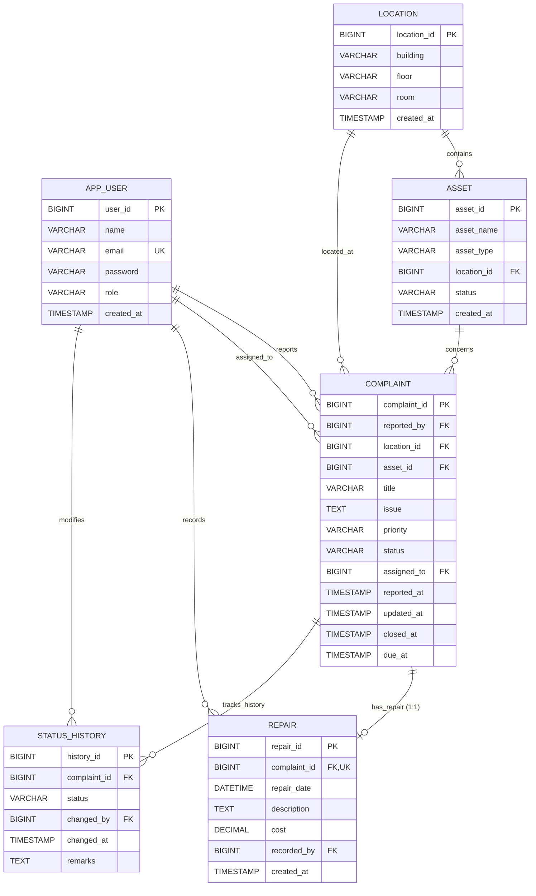

# Database Design & Schema Specification

The **Campus Maintenance & Accountability System** relies on a MySQL 8.0 relational database designed with 6 interconnected tables. The schema enforces strict integrity constraints, foreign key validation, 1:1 repair mapping, and immutable audit logs.

---

## 1. Relational Tables Overview

### 1.1 `app_user`
Stores authentication credentials, user contact info, and system roles.
- **Primary Key:** `user_id` (BIGINT, AUTO_INCREMENT)
- **Unique Constraints:** `email` (VARCHAR 150)
- **Check Constraints:** `role IN ('USER', 'MAINTENANCE_STAFF')`
- **Columns:**
  - `user_id`: Unique identifier for the user.
  - `name`: User's full name.
  - `email`: User's email address (used as login username).
  - `password`: BCrypt hashed password string.
  - `role`: Role string (`USER` or `MAINTENANCE_STAFF`).
  - `created_at`: Record creation timestamp.

### 1.2 `location`
Catalog of physical campus locations where equipment and assets reside.
- **Primary Key:** `location_id` (BIGINT, AUTO_INCREMENT)
- **Unique Constraints:** `uk_location_building_floor_room` ON (`building`, `floor`, `room`)
- **Columns:**
  - `location_id`: Unique location identifier.
  - `building`: Building name (e.g., "Science Block").
  - `floor`: Floor level (e.g., "2nd Floor").
  - `room`: Room designation (e.g., "Lab 204").
  - `created_at`: Timestamp when the location was added.

### 1.3 `asset`
Physical equipment registered to campus locations.
- **Primary Key:** `asset_id` (BIGINT, AUTO_INCREMENT)
- **Foreign Keys:**
  - `location_id` → `location(location_id)` ON DELETE RESTRICT
- **Check Constraints:** `status IN ('FUNCTIONAL', 'UNDER_MAINTENANCE', 'FAULTY', 'DECOMMISSIONED')`
- **Columns:**
  - `asset_id`: Unique asset identifier.
  - `asset_name`: Name or title of the asset.
  - `asset_type`: Asset classification (e.g., "Electronics", "HVAC", "Hardware").
  - `location_id`: Associated location.
  - `status`: Operational status.
  - `created_at`: Timestamp when recorded.

### 1.4 `complaint`
Central maintenance ticket repository.
- **Primary Key:** `complaint_id` (BIGINT, AUTO_INCREMENT)
- **Foreign Keys:**
  - `reported_by` → `app_user(user_id)` ON DELETE RESTRICT
  - `location_id` → `location(location_id)` ON DELETE RESTRICT
  - `asset_id` → `asset(asset_id)` ON DELETE RESTRICT (Nullable for general building issues)
  - `assigned_to` → `app_user(user_id)` ON DELETE RESTRICT (Nullable until assigned)
- **Check Constraints:**
  - `priority IN ('LOW', 'MEDIUM', 'HIGH', 'URGENT')`
  - `status IN ('REPORTED', 'ASSIGNED', 'IN_PROGRESS', 'COMPLETED', 'CLOSED')`
- **Columns:**
  - `complaint_id`: Ticket primary key.
  - `title`: Short title of the problem.
  - `issue`: Full textual problem description.
  - `priority`: Urgency level.
  - `status`: Current state machine status.
  - `reported_at`: Submission timestamp.
  - `updated_at`: Auto-updated timestamp on modification.
  - `closed_at`: Timestamp when marked CLOSED.
  - `due_at`: Expected resolution SLA date.

### 1.5 `repair`
Formal repair record created by maintenance technicians before marking a complaint as `COMPLETED` or `CLOSED`.
- **Primary Key:** `repair_id` (BIGINT, AUTO_INCREMENT)
- **Unique Constraints:** `complaint_id` (Enforces strict 1:1 relationship between complaint and repair)
- **Foreign Keys:**
  - `complaint_id` → `complaint(complaint_id)` ON DELETE RESTRICT
  - `recorded_by` → `app_user(user_id)` ON DELETE RESTRICT
- **Check Constraints:** `cost >= 0`
- **Columns:**
  - `repair_id`: Unique repair record identifier.
  - `complaint_id`: Foreign key reference to the repaired ticket (UNIQUE).
  - `repair_date`: Date and time when repair was performed.
  - `description`: Textual summary of repair operations and parts replaced.
  - `cost`: Monetary cost of repair (DECIMAL 10,2).
  - `recorded_by`: Maintenance staff user ID who performed and recorded the repair.
  - `created_at`: System timestamp.

### 1.6 `status_history`
Immutable log recording every state transition throughout a complaint's lifecycle.
- **Primary Key:** `history_id` (BIGINT, AUTO_INCREMENT)
- **Foreign Keys:**
  - `complaint_id` → `complaint(complaint_id)` ON DELETE RESTRICT
  - `changed_by` → `app_user(user_id)` ON DELETE RESTRICT
- **Check Constraints:** `status IN ('REPORTED', 'ASSIGNED', 'IN_PROGRESS', 'COMPLETED', 'CLOSED')`
- **Columns:**
  - `history_id`: Unique audit log ID.
  - `complaint_id`: Related complaint ticket.
  - `status`: The target status applied.
  - `changed_by`: User ID who initiated the transition.
  - `changed_at`: Timestamp of change.
  - `remarks`: Optional remarks or explanation.

---

## 2. Relationships & Cardinalities

```
[app_user] 1 ──── N [complaint] (as reported_by)
[app_user] 1 ──── N [complaint] (as assigned_to)
[app_user] 1 ──── N [repair] (as recorded_by)
[app_user] 1 ──── N [status_history] (as changed_by)

[location] 1 ──── N [asset]
[location] 1 ──── N [complaint]

[asset]    1 ──── N [complaint] (Nullable)

[complaint] 1 ──── 1 [repair] (Enforced via UNIQUE index on repair.complaint_id)
[complaint] 1 ──── N [status_history]
```

### Purpose of Key Design Decisions
1. **ON DELETE RESTRICT:** Foreign keys prevent hard deletion of users, locations, or assets that have active or historical complaint records, preserving compliance and audit trails.
2. **1:1 Complaint-Repair Rule:** A complaint cannot have multiple repair records, nor can a repair exist without a valid complaint ticket.
3. **Auditability:** `status_history` guarantees that no ticket status change occurs silently or anonymously.

---

## 3. Entity-Relationship (ER) Diagram


