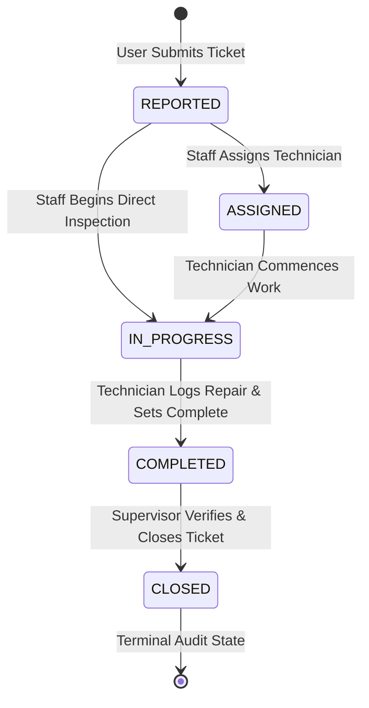

# Complaint Lifecycle State Machine & Workflow Documentation

This document describes the state machine workflow governing maintenance ticket resolution in the **Campus Maintenance & Accountability System**.

---

## 1. Complaint Status Lifecycle State Machine

The complaint state machine transitions through 5 defined status states:

---

## 2. Transition Guard Rules & Validation Mechanics

The backend `ComplaintServiceImpl` enforces strict validation rules at every state transition. Any illegal attempt to bypass states or violate prerequisites results in an `InvalidStatusTransitionException` (`HTTP 400 Bad Request`).

### 2.1 State Transition Matrix

| From Status (`current`) | Allowed Target Status (`target`) | Role Authorization | Prerequisite / Guard Rule |
| :--- | :--- | :--- | :--- |
| `REPORTED` | `ASSIGNED` | `MAINTENANCE_STAFF` | Requires selecting a valid staff user (`assignedToStaffId`). |
| `REPORTED` | `IN_PROGRESS` | `MAINTENANCE_STAFF` | Direct work initiation without explicit assignment step. |
| `ASSIGNED` | `IN_PROGRESS` | `MAINTENANCE_STAFF` | Commences active repair work. |
| `IN_PROGRESS` | `COMPLETED` | `MAINTENANCE_STAFF` | **STRICT GUARD:** Requires a logged record in the `repair` table. |
| `COMPLETED` | `CLOSED` | `MAINTENANCE_STAFF` | Requires repair log. Sets `closed_at` timestamp. |
| `CLOSED` | *None* | *None* | **TERMINAL STATE:** Immutable; no further modifications permitted. |

---

## 3. Mandatory Repair Record Prerequisite

To prevent unresolved tickets from being closed prematurely, the system enforces a key institutional constraint:

$$\text{Transition to } \text{COMPLETED} \lor \text{CLOSED} \iff \exists \text{ Repair Record } (\text{complaint\_id})$$

If `repairRepository.existsByComplaint_ComplaintId(complaintId)` returns `false`:
- The backend rejects the request with message: `"A repair record must be logged before completing or closing a complaint"`.
- The ticket remains in `IN_PROGRESS` state.

---

## 4. Automatic SLA Due Date Calculation

Upon ticket creation (`POST /api/complaints`), the system calculates `due_at` based on ticket priority:

- **`URGENT`**: Reported At + 24 Hours (1 Day)
- **`HIGH`**: Reported At + 48 Hours (2 Days)
- **`MEDIUM`**: Reported At + 5 Days
- **`LOW`**: Reported At + 7 Days

Tickets exceeding `due_at` while not in terminal `CLOSED` state are flagged on the **SLA Overdue Complaints** dashboard.

---

## 5. Audit Logging via `status_history`

Every valid status transition triggers an automatic database transaction saving an immutable entry into `status_history`:

- `history_id`: Unique sequence primary key.
- `complaint_id`: Target ticket ID.
- `status`: New target status applied.
- `changed_by`: User ID of staff or user initiating change.
- `changed_at`: System timestamp.
- `remarks`: Explanatory remarks or technician notes.

This guarantees complete traceability and non-repudiation for campus maintenance operations.
